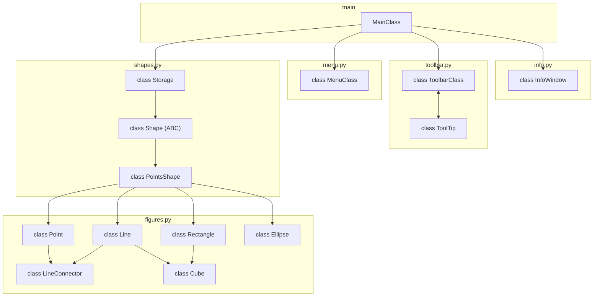

# Lab4: Вдосконалення структури коду графічного редактора об’єктів
 
### Мета 
Отримати вміння та навички проектування класів, виконавши модернізацію коду графічного редактора в об’єктно-орієнтованому стилі для забезпечення зручного додавання нових типів об'єктів


### Завдання

1. Створити у середовищі розробки проект з ім’ям Lab4.
2. Написати вихідний текст програми згідно варіанту завдання.
3. Скомпілювати вихідний текст і отримати виконуваний файл програми.
4. Перевірити роботу програми. Налагодити програму.
5. Проаналізувати та прокоментувати результати та вихідний текст програми.
6. Оформити звіт.


## Варіант завдання — №15 (Ж = 15)

Усі параметри обчислено за формулами для номера за журналом **Ж = 15**:

| Параметр | Умова за варіантом |
| :--- | :--- |
| Об'єкт класу `MyEditor` | Глобальний статичний об'єкт |
| «Гумовий» слід при вводі фігур | Пунктирна лінія чорного кольору |
| Сховище для збереження об'єктів | Динамічний масив об'єктів `Shape` |
| Базові типи фігур | Крапка, Лінія, Прямокутник, Еліпс |
| Нові типи фігур | Лінія з кружечками, Каркас куба |
| Реалізація «Лінії з кружечками» | Множинне успадкування від `Line` та `Ellipse` (або `Point`) |
| Реалізація «Каркасу куба» | Множинне успадкування від `Rectangle` та `Line` |
| Елементи керування (Toolbar) | Кнопки Toolbar з підказками (Tooltips) |
| Меню програми | Меню «Об'єкти» з індикацією обраного інструмента |

### Схема успадкування



### Структура проєкту

```text 
./ 
├── icons/
├── widgets/
│   ├── menu.py
│   └── toolbar.py
├── main.py
├── info.py
├── shapes.py
├── figures.py
└── README.md
```