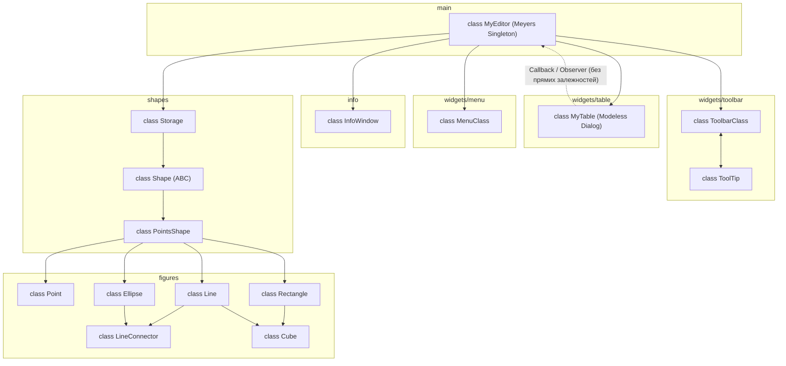

# Lab5: Розробка багатовіконного інтерфейсу користувача для графічного редактора об'єктів
 
### Мета 
Отримати вміння та навички програмувати багатовіконний інтерфейс програми в об’єктно-орієнтованому стилі


### Завдання

1. Створити у середовищі розробки проект з ім’ям Lab5
2. Написати вихідний текст програми згідно варіанту завдання
3. Скомпілювати вихідний текст і отримати виконуваний файл програми
4. Перевірити роботу програми. За потреби налагодити програму
5. Проаналізувати та прокоментувати результати та вихідний текст програми
6. Оформити звіт


## Варіант завдання — №15 (Ж = 15)

Усі параметри обчислено за формулами для номера за журналом **Ж = 15**:

| Параметр | Умова за варіантом | Розрахунок / Примітка |
| :--- | :--- | :--- |
| Об'єкт класу `MyEditor` | Глобальний статичний об'єкт у вигляді **Singleton Меєрса** | $15 \pmod 2 = 1$ (непарний номер) |
| Кольори та стилі фігур | Як у попередній лабораторній роботі №4 | Усі 6 типів геометричних форм |
| «Гумовий» слід при вводі | Пунктирна лінія чорного кольору | `dash=(4, 2)` для всіх фігур |
| Вікно таблиці об'єктів | Немодальне діалогове вікно (клас `MyTable`) | Окремий модуль `table.py` / `widgets/table.py` |
| Керування вікном таблиці | Окремий пункт у меню програми | Відкриття та закриття вікна таблиці |
| Синхронізація закриття | Автоматичне закриття таблиці при виході з програми | Обробка закриття головного вікна |
| Збереження об'єктів у файл | Запис множини об'єктів у форматі CSV | Поля: `type, x1, y1, x2, y2` |
| Архітектура модулів | Відкритість до розширення без переписування модулів (OCP) | Додавання нових фігур без зміни логіки редактора |

### Формат таблиці графічних об’єктів

Вікно таблиці відображає поточний список створених геометричних об'єктів:

| Назва | x1 | y1 | x2 | y2 |
| :--- | :--- | :--- | :--- | :--- |
| Точка | 10 | 130 | 10 | 130 |
| Лінія | 45 | 23 | 400 | 327 |
| Еліпс | 123 | 304 | 257 | 412 |
| Прямокутник | 50 | 60 | 180 | 140 |
| Лінія з кружечками | 70 | 80 | 250 | 200 |
| Каркас куба | 100 | 100 | 200 | 200 |

### Бонуси-заохочення

| № | Бонус | Опис реалізації |
| :-: | :--- | :--- |
| **1** | **Підсвічування фігури** | При виділенні курсором рядка таблиці відповідний об'єкт виділяється на зображенні у головному вікні |
| **2** | **Вилучення фігури** | При виділенні курсором рядка таблиці відповідний об'єкт вилучається зі сховища (`Storage`) та перемальовується полотно |
| **3** | **Завантаження з файлу** | Програма не лише зберігає опис множини об'єктів у файл CSV, а й завантажує їх із відображенням у головному вікні та таблиці |

> [!IMPORTANT]
> **Архітектурне обмеження для бонусів 1 та 2:**  
> Забороняється створювати прямі залежності модуля таблиці від інших модулів редактора (`main.py`, `shapes.py` тощо). Взаємодія між вікном таблиці та головним редактором реалізується через **механізм зворотних викликів (Callback)** або патерни **Observer / Listener**.

### Схема успадкування та взаємодії класів



### Структура проєкту

```text 
./ 
├── icons/
├── widgets/
│   ├── menu.py
│   ├── toolbar.py
│   └── table.py
├── main.py
├── info.py
├── shapes.py
├── figures.py
└── README.md
```
